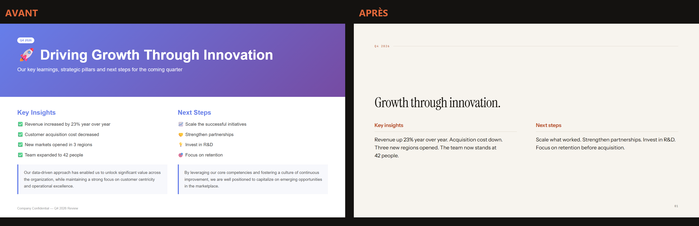

# Deckhand

**Editorial slides for coding agents.** Your agent writes the content. Deckhand makes the layout look like a studio did it.

[](LICENSE)
[](package.json)
[](package.json)
[](https://github.com/iruzen-dono/deckhand/actions/workflows/ci.yml)


**[See the live deck →](https://iruzen-dono.github.io/deckhand/)** · [PDF](https://iruzen-dono.github.io/deckhand/deck.pdf) · 8 slides, no install.

---

## The problem

Ask an agent for a presentation and you get the same thing every time: a gradient
hero, a white body, two equal columns, emoji as iconography, a bold Arial heading.
The content is fine. The layout tells the room that nobody designed it.

Deckhand is the missing layer. You write one small HTML fragment per slide, using
eight fixed layouts. The build assembles them into one self-contained file, then
exports PDF and PNG. The typography, the grid, the accent and the spacing are
already decided — the agent only fills in the content.



Same content. Left: the model's default output. Right: the same text, through Deckhand.

## Try it in 30 seconds

```bash
# no install, straight from the repo
npx github:iruzen-dono/deckhand build examples/pitch dist
```

```bash
git clone https://github.com/iruzen-dono/deckhand
cd deckhand
node bin/deckhand.js build examples/pitch dist
node bin/deckhand.js audit dist        # 0 overflows or it fails
```

Output:

```
dist/deck.html    one self-contained file — fonts inlined, 325 KB, works offline
dist/deck.pdf     one page per slide, fonts embedded
dist/png/01.png   … one image per slide, 1600×900
```

## Install the skill

```bash
node bin/deckhand.js install              # → ~/.claude/skills/deckhand
node bin/deckhand.js install --target codex
```

Then ask your agent for a deck. `SKILL.md` tells it which layout to use for which
content shape, the content rules (one idea per slide, six lines maximum, one
accent), and the anti-patterns it must refuse.

Supported: Claude Code, Codex, Cursor, and anything that reads a `SKILL.md`.

## The 8 layouts

| Layout | For | |
|---|---|---|
| `cover` | the opening claim | [01](docs/slides/01.png) |
| `section` | a turning point in the narrative | [02](docs/slides/02.png) |
| `list` | 3–4 parallel points | [03](docs/slides/03.png) |
| `data` | one number that changes the argument | [04](docs/slides/04.png) |
| `quote` | one sentence worth remembering | [05](docs/slides/05.png) |
| `two-col` | comparison, before/after | [06](docs/slides/06.png) |
| `full` | full-bleed image with a caption | [07](docs/slides/07.png) |
| `end` | the action you want | [08](docs/slides/08.png) |

Three themes: `paper` (warm off-white, default), `ink` (near-black), `night` (deep blue).
Add the class to a slide: `class="slide slide--quote theme-ink"`.

## What's inside

- **Type:** Instrument Serif, Instrument Sans, JetBrains Mono — embedded as base64,
  SIL OFL. The deck renders identically on any machine, online or offline.
- **Colour:** one accent, terracotta `#b4451f`. No gradients, no glass, no glow.
- **Layout:** 1600×900, 96 px margins, a 64 px header band for the kicker.
- **Build:** plain Node, no dependency, no framework. Chromium does the PDF and PNG.

## Verified, not claimed

| Check | Result |
|---|---|
| W3C Nu HTML | 0 errors, 0 warnings |
| Slide overflow (measured in the live DOM) | 0 across 8 slides |
| Text contrast | ≥ 4.5:1 on every pair |
| Structural rule contrast | 3.26:1 paper · 3.29:1 ink · 3.05:1 night |
| PDF | 8 pages, fonts embedded, 247 KB |
| `deck.html` | 325 KB, 0 external network requests |

## What it isn't

Not PowerPoint. No animations, no templates, no drag and drop, no collaboration,
no cloud, no AI inside. A deck is a folder of small HTML files and a build
command — which is exactly why an agent can write one reliably.

## Repo layout

```
assets/deck.css     the whole design system, hand-written
assets/fonts.css    embedded fonts (generated)
examples/pitch/     the 8-slide demo
examples/before/    the "generated by default" comparison
scripts/build.mjs   assemble + PDF + PNG
scripts/audit.mjs   overflow detector
scripts/site.mjs    builds docs/ for GitHub Pages
SKILL.md            the agent instructions
```

## Contributing

Design changes are judged visually. Read [CONTRIBUTING.md](CONTRIBUTING.md) first —
new colours, gradients and extra dependencies are rejected on principle.

## License

MIT. Fonts under SIL Open Font License.
